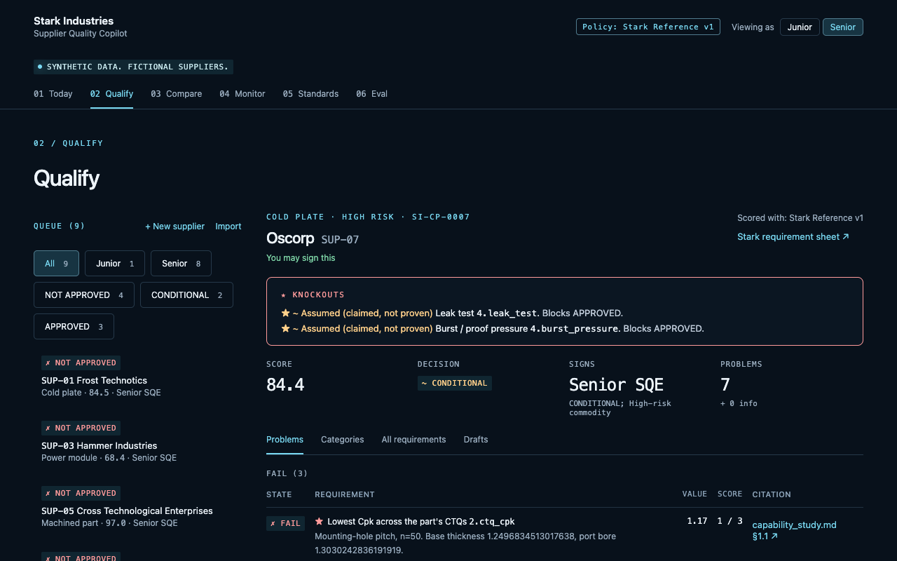
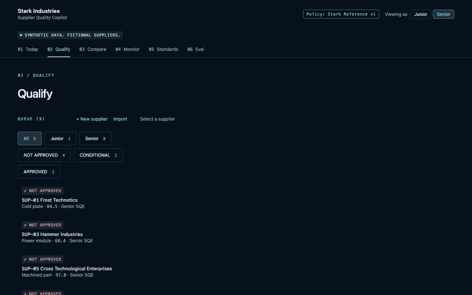

# Supplier Quality Copilot

**An agentic workflow that clears the new-supplier qualification backlog for a small supplier-quality team during a hardware ramp.**

Ingest a supplier's qualification packet → the agent extracts evidence with citations → a deterministic rubric engine scores it → the workbench shows gaps, risk tier, who must sign off, and a drafted request-for-information. Once approved, the supplier moves onto a live scorecard (DPPM, escapes, repeat NCs, SCAR aging, on-time delivery) with trend alerts.

**Live demo:** https://siddardth7.github.io/supplier-quality-copilot/ (opens on the Today view)





The demo path: queue -> SUP-07 -> citation -> RFI draft -> Monitor run-rule alert, 24 s.

## Results

**v1.0** is released: product docs, engine, simulated dataset, agent, workbench UI and ship (milestones M1 to M6). See the [release notes](docs/RELEASE-v1.0.md) and [docs/ROADMAP.md](docs/ROADMAP.md).

The agent was measured on its first Sonnet run over four unseen simulated worlds (101 to 104, pooled). The answer keys were locked by hash before the run, the results are published as measured, and the skill was not tuned afterward.

| Measure | Result | Target | Verdict |
|---|---|---|---|
| Catch (planted gaps found) | 71/73 (97.3%) | ≥ 90% | PASS |
| False alarm (clean rows flagged) | 108/1079 (10.0%) | ≤ 5% | **FAIL** |
| Decision agreement | 30/36 (83.3%) | none | - |

It meets the catch target and misses the false-alarm target. A separate Opus comparison run, not the headline, caught 73/73 with 0 false alarms. Details in [docs/EVAL.md](docs/EVAL.md).

## Worked example

The engine's result for SUP-07 in the committed dataset:

```
SUP-07 Oscorp · Cold plate · NEW (NPI) · High risk
Score 84.4 / 100 · CONDITIONAL · Route → Senior SQE (CONDITIONAL; High-risk commodity)
Knockouts: none fail, 2 assumed · Fails: 3 · Assumed: 4 · Missing: 0
  ✗ ★ CTQ Cpk = 1.17 (< 1.33)                 Process control · capability_study.md §1.1
  ✗ Capacity ÷ peak demand = 0.83 (< 1.2)     Capacity & ramp · capacity.md §1.1
  ✗ Quoted lead time 15 wk, need-by 12 wk     Capacity & ramp · capacity.md §9.1
  ~ CAPA process claimed, no records          Quality system · quality_manual.md §1.1
  ~ ★ Leak test claimed, no leak-rate data    Reliability · reliability_report.md §1.1
  ~ ★ Burst pressure claimed, no proof data   Reliability · reliability_report.md §9.1
  ~ NC segregation claimed, no records        Traceability · quality_manual.md §1.9
Drafted: RFI email (4 items) · audit focus plan (Cpk, leak test, burst pressure)
```

[RUBRIC.md](docs/RUBRIC.md#worked-example-sup-07) works the scoring through by hand on a hand-built SUP-07 example; its numbers differ from the committed dataset's.

## Why this exists

An AI hardware company's small supplier-quality team is ramping a liquid-cooled system. New parts mean new suppliers, and **qualifying them is the backlog**. The team wants agentic workflows that let each engineer cover more ground. This project is that workflow. Full framing is in [PRD-00](docs/product/PRD-00-overview.md).

## Design principles

1. **The AI reads and drafts. The engine scores. A human decides.** No score is ever generated by an LLM.
2. **Every claim has a citation or is marked missing.** Verified, assumed and missing are three different states. That's the JD line "distinguish facts from assumptions" turned into a data model.
3. **Routing follows delegated authority.** Low-risk, complete packets go to a junior for sign-off. High-risk commodities, sole sources and knockouts go to a senior.
4. **Quality and reliability together.** The rubric requires commodity-specific reliability evidence (leak, thermal cycling, burn-in), not just certificates.
5. **Measured, not claimed.** Synthetic packets have planted gaps with an answer key, so the agent's catch rate is a number ([docs/EVAL.md](docs/EVAL.md)).

## Run it

No install step, no dependencies. You need Node 22.7 or newer to serve and to run `node --test`; the repo is developed and CI-tested on Node 26. Any current browser works.

```
git clone https://github.com/Siddardth7/supplier-quality-copilot.git && cd supplier-quality-copilot
node scripts/serve.mjs            # serves the repo root on port 8000
open http://localhost:8000/app/   # from a second terminal, or paste the URL into a browser
```

If port 8000 is taken, run `node scripts/serve.mjs 8001`; the URL changes to match. Every view is a deep link, for example `#view=qualify&supplier=SUP-07` or `#view=monitor&active=ACT-02`. Run the tests with `node --test`.

Use `scripts/serve.mjs` rather than `python3 -m http.server`: Python's server queues only 5 connections, and a cold load of the app's ES modules resets some of them, leaving a half-built page. Opening `app/index.html` from disk (`file://`) does not work, because browsers block ES modules and `fetch` there.

Before anything goes public, `node scripts/scrub.mjs` (add `--history` for every past blob) checks the tree and commit messages against a local, gitignored `.scrub-terms` list; it exits 2 if that file is missing.

## What's in the repo

| Path | What |
|---|---|
| `app/` | Static web workbench (vanilla HTML/CSS/JS, no build) and the scoring engine |
| `data/` | Synthetic supplier packets, extractions, requirement sheets, 18-month quality history, eval worlds and results |
| `agent/` | Claude Code skill for evidence extraction, the eval script, and the blind-run kit |
| `sim/` | The simulator that generates the synthetic worlds and answer keys |
| `scripts/` | Local server, scrub check, dev-world builder and dataset helpers |
| `design/` | Design tokens (RoLaMGAS-style dark instrument UI) |
| `docs/` | Product requirements (`docs/product/`), rubric, scorecard math, dataset spec, eval results, roadmap |
| `docs/img/` | README screenshot, demo GIF and the handout's six view screenshots |

## Docs

- [PRD-00 overview](docs/product/PRD-00-overview.md): the problem, users and goals
- [RUBRIC.md](docs/RUBRIC.md): how a packet is scored, decided and routed
- [SCORECARD.md](docs/SCORECARD.md): the monitoring math (tiers, p-chart, run rules)
- [DATASET.md](docs/DATASET.md): the synthetic dataset
- [EVAL.md](docs/EVAL.md): the agent's measured results
- [HANDOUT.md](docs/HANDOUT.md): the one-page handout ([PDF](docs/HANDOUT.pdf))
- [DEMO.md](docs/DEMO.md): the 3-minute demo script, one deep link per step
- [ROADMAP.md](docs/ROADMAP.md): milestones and decisions

## Data disclaimer

All suppliers, documents and numbers are **fictional and synthetic**. Stark Industries and the supplier names are Marvel comic-book companies, used as a fan reference; this project is not affiliated with Marvel. They're modeled on general, public knowledge of liquid-cooled AI hardware. Nothing here comes from any company's internal data.
