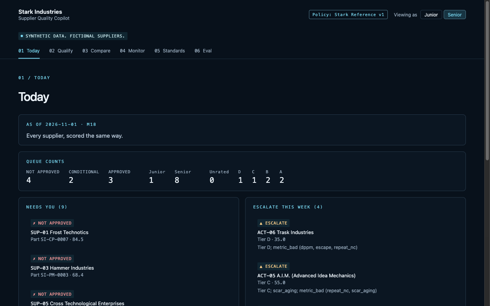
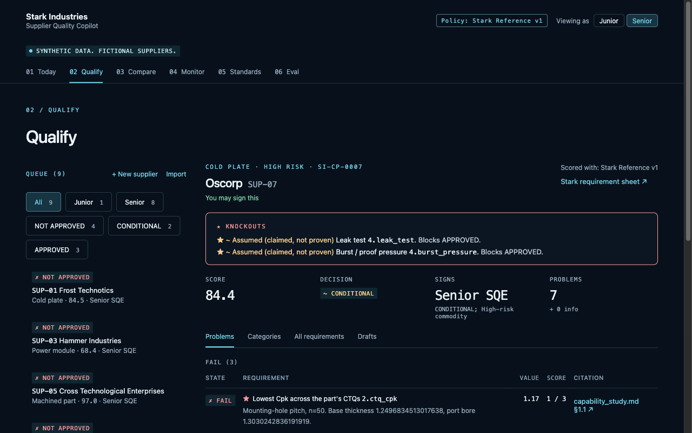
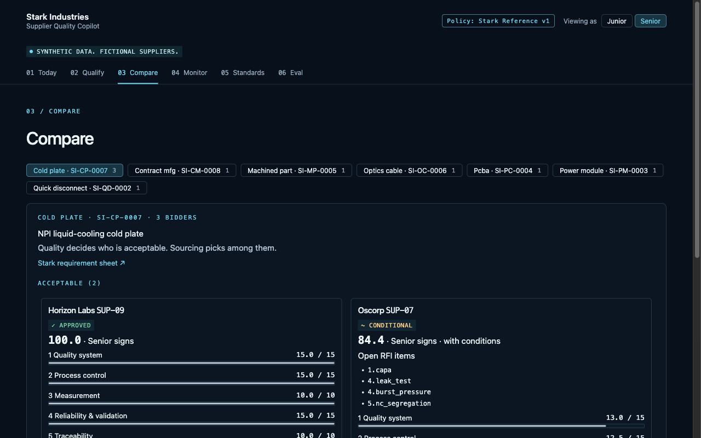
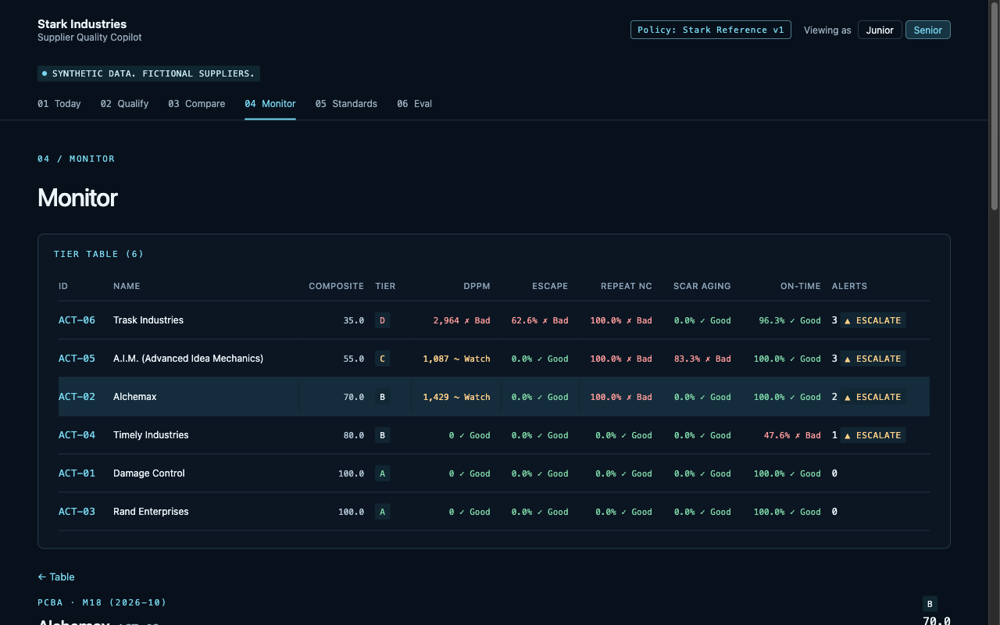
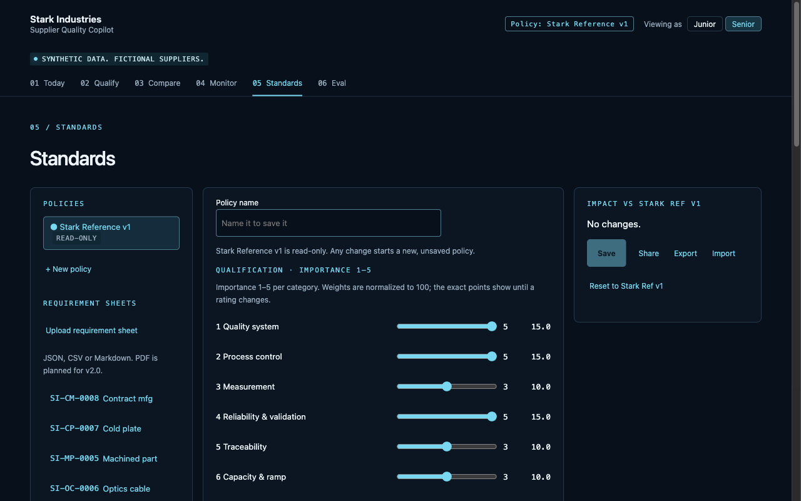
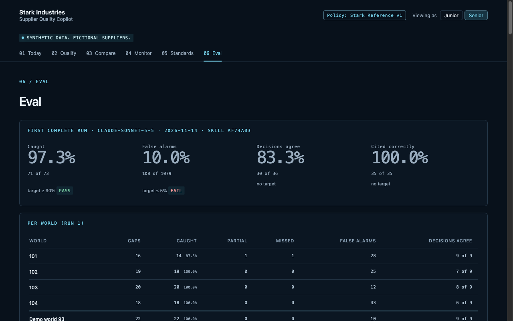

# Supplier Quality Copilot

**An agentic workflow that clears the new-supplier qualification backlog.** Live: https://siddardth7.github.io/supplier-quality-copilot/

## The problem

A small supplier-quality team is ramping a liquid-cooled system. New parts mean new suppliers, and qualifying them is the backlog: each packet is a stack of documents to read against a requirement sheet, and the senior engineers are the bottleneck.

## How it works

| 1 Packet | 2 Agent | 3 Engine | 4 Routing | 5 Person |
|---|---|---|---|---|
| Supplier documents and the Stark requirement sheet | Extracts evidence only: a state, a value and a citation per requirement | Pure functions score it. No score ever comes from an LLM | A fixed rule names who may sign | Reviews the cited gaps and the drafted RFI, then signs |

Every requirement is **verified**, **assumed** (claimed, not proven) or **missing**. A claim without proof never scores as a fact. Approved suppliers move onto a monthly scorecard (DPPM, escapes, repeat NCs, SCAR aging, on-time delivery) with p-chart run rules.

## The routing rule

| Result | Rule |
|---|---|
| **APPROVED** | Total ≥ 85, no knockout failed, no knockout assumed |
| **CONDITIONAL** | No knockout failed, and 70 ≤ total < 85 or a knockout is assumed |
| **NOT APPROVED** | Total < 70, or any knockout failed |

A **junior SQE** may sign when the result is APPROVED, the risk class is Low or Medium, and a second source is confirmed. A **senior SQE** signs everything else. Example: Oscorp's cold plate scores 84.4 with leak test and burst pressure only claimed: CONDITIONAL, high-risk, so a senior signs.

## The six views

| Today | Qualify | Compare |
|---|---|---|
|  |  |  |

| Monitor | Standards | Eval |
|---|---|---|
|  |  |  |

## Measured, not claimed

On four simulated supplier worlds the agent had never seen, with answer keys locked by hash before the run:

| Measure | Result | Target | Verdict |
|---|---|---|---|
| Planted gaps caught | 71 / 73 (97.3%) | ≥ 90% | PASS |
| Clean rows flagged (false alarms) | 108 / 1079 (10.0%) | ≤ 5% | FAIL |

Both are published as measured; the skill was not tuned after the run. Every false alarm is the agent marking a verified item as only assumed: too cautious, never too trusting. That is why a person still signs.

## Three questions for you

1. What is your junior delegation threshold today, and who set it?
2. Would you approve on a supplier's claim for a knockout item? This rubric caps it at CONDITIONAL.
3. Do you weight categories by commodity, or use one rubric for every part?

All data is synthetic. The buyer is Stark Industries and the suppliers carry Marvel comic-book company names; this project is fan-made and not affiliated with Marvel.
